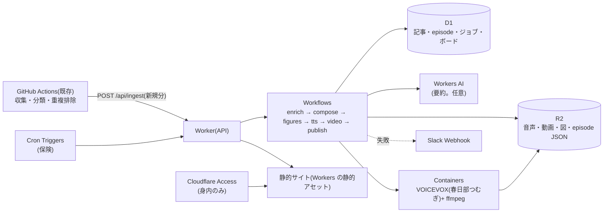

# ResearchBroadcast 設計書(第2版)

作成日: 2026-10-11(改訂)/ 対象: Research-Collector の収集結果を、ニュース・広告風の見た目と構成で、サイト・音声・図・動画として提供する出力側の拡張
**決定事項(本人の指示)**
1. 利用範囲: **自分用(身内向け)**。「広告風」は見た目と構成の話(実際の広告表示ではない)
2. 声: **VOICEVOX の春日部つむぎ**(RAGReel と共通)
3. バックエンド: **Cloudflare**
4. 表示: **収集カテゴリ別**
5. 自動化: 収集後の生成・公開も**自動**にする(手動工程を残さない設計にする)

関連: [UI_DESIGN_PRINCIPLES_2026-10.md](../UI_DESIGN_PRINCIPLES_2026-10.md)、[IMPROVEMENT_DESIGN_2026-10.md](IMPROVEMENT_DESIGN_2026-10.md)(`results.html`)、[RAGReel/docs/narration-quality.md](../RAGReel/docs/narration-quality.md)

---

## 0. 先に答え: 今回の部分は自動化されているか

| 工程 | 第1版の設計 | **第2版(この設計書)** |
|---|---|---|
| 収集・重複排除・分類 | 自動(GitHub Actions。既存) | 変わらない |
| 要約・見出し | 未設計 | **自動**(Cloudflare 上) |
| episode(番組表)の生成 | 未設計 | **自動** |
| サイトの更新・公開 | 自動(Actions) | **自動**(Cloudflare 上) |
| 図(SVG) | 自動(Actions) | **自動** |
| 音声(春日部つむぎ) | **手元PCで手動** | **自動**(Cloudflare Containers。下記の前提つき) |
| 週次動画 | **手元PCで手動(RAGReel)** | **自動**(簡易版。Containers 上の ffmpeg)。RAGReel は任意の高品質版として残す |
| 失敗の通知 | 既存(Issue) | **自動**(Slack など) |

**自動化の前提(費用)**: Workers の **Paid プラン(月5ドル)** が必要。Containers は Free プランでは使えず、Workflows と Cron Trigger も Free では CPU 時間が 10ms に制限されるため(確認済み。第4章)。

**Containers が使えなかった場合の保険**: 手元 PC のタスクスケジューラで音声だけを生成し、Cloudflare へアップロードする(PC の電源が入っている間のみ。第7章)。

---

## 1. 入力と「収集カテゴリ」(確認済み)

### 1.1 カテゴリ
`nbklm/notebook_ids.py` の振り分けルールがそのままカテゴリの定義になる。

| カテゴリ(表示名) | 内部名 | 入る収集元(source_type) |
|---|---|---|
| Game-Dev-Tech | `game_dev_tech` | zenn, qiita, unity, unreal, houdini |
| Graphics-Research | `graphics_research` | unity, unreal, cedec, gdc, houdini |
| Software-Engineering | `software_engineering` | paper, arxiv, cloudflare, model, x_post |

- **1つの記事が複数のカテゴリに入る**(例: unity / unreal / houdini は2カテゴリ。cedec / gdc は2026-10-11に Graphics-Research のみに変更)。
- `articles_log.json` の各行は、すでに **`categories`**(配列)・`label`・`keywords`・`review`・`status`・`published`・`collected_at` を持つ。**カテゴリ別の表示に必要な項目は揃っている**。
- **ローカル限定の分野(`notebook_ids_local.py` / `local_collect_extra.py`)は、ログに書かれず、このサイトにも出さない**(既存の隔離方針を守る)。

### 1.2 実行の時刻(UTC。JST は +9 時間)
| 収集 | cron | JST |
|---|---|---|
| 日次 | `0 9,21 * * *` | 18:00 と 06:00 |
| 週次ダイジェスト | `0 22 * * 2,6` | 水曜と日曜の 07:00 |

### 1.3 足りないもの
- 記事ごとの**要約**(現状のログはタイトルと URL のみ)。第6章。

---

## 2. カテゴリ別の表示(UI の構成)

### 2.1 情報構造(カテゴリが主役)
```
/                        今日の放送(3カテゴリのレーンが並ぶ。全体のヘッドライン)
/c/game-dev-tech         カテゴリ別ページ(Game-Dev-Tech)
/c/graphics-research     同(Graphics-Research)
/c/software-engineering  同(Software-Engineering)
/board                   ボード(未読 / 読む / 試す / 保留)。カテゴリで絞り込み
/weekly/2026-W41         週次特集(カテゴリ別の章立て)
/status                  収集・生成の状態(失敗の一覧)
```

### 2.2 トップ「今日の放送」
```
┌ 見出し(1語だけ差し色)  今日の放送  2026-10-11 ───── 取得 38 · 新規 22 · 失敗 1 ┐
│ [▶ 全体を再生]  [Game-Dev-Tech ▶] [Graphics-Research ▶] [Software-Engineering ▶]  ← カテゴリ別の音声
├──────────────┬──────────────┬──────────────┤
│ Game-Dev-Tech │ Graphics-Res.│ Software-Eng. │  ← カテゴリのレーン(列)
│  新着 9 件    │  新着 7 件   │  新着 8 件    │
│  1. 見出し    │  1. 見出し   │  1. 見出し    │
│  2. …         │  2. …        │  2. …         │
│  [すべて見る] │              │               │
└──────────────┴──────────────┴──────────────┘
下部固定: ▶ 再生バー(カテゴリごとのチャプター)
```
- 複数カテゴリに入る記事は、**両方のレーンに出す**。2つ目以降は「ほかのカテゴリにも」バッジを付け、**重複して数えない**(全体の件数は URL 単位)。
- スマホ幅では、レーンを縦に積み、カテゴリのチップで切り替える。

### 2.3 カテゴリ別ページ
- 上: カテゴリの**今日のヘッドライン**(1行)と、そのカテゴリの音声(30〜45秒)。
- 左: 収集元のチップ(Zenn / Qiita / SideFX …)と、件数。上: 期間(今日 / 今週 / 先月)のセグメントコントロール。
- 中央: 記事の行(記号 + 見出し + 副題 + 日付 + 関連プロジェクトのバッジ)。クリックでドロワー。
- 右: 小さな図(そのカテゴリの週次推移・収集元別件数)。
- 「要確認(分類できなかった記事)」は、橙のチップで別に出す。

### 2.4 週次特集
- カテゴリごとの章。スクロールテリング(文章に合わせて固定の図が切り替わる)。週次動画を先頭に置く。

### 2.5 UI パーツ(チートシート 24 の名前)
| パーツ | 使う場所 |
|---|---|
| ドロワー(スマホはボトムシート) | 記事の詳細 |
| チップ | 収集元・関連プロジェクトの絞り込み |
| セグメントコントロール | 期間、表示(一覧 / ボード) |
| タブ | 放送 / ボード / 特集 |
| トースト | 「ボードに追加しました」 |
| スケルトン | 読み込み中 |
| バッジ | 未読数、要確認の件数、「ほかのカテゴリにも」 |
| アコーディオン | 失敗した収集元・生成ジョブの一覧 |
| エンプティステート | 該当なし |
| ツールチップ | 関連プロジェクトの説明 |
| パンくず | 週次特集 > 週 > カテゴリ |

### 2.6 Motion(スクロール演出チートシート 24 の名前)
| 動き | 使う場所 |
|---|---|
| カウントアップ | トップの数値 |
| フェードイン / スタッガー | レーンの行・カード |
| テキストリビール | トップの見出し(1回) |
| マーキー | 上部の「速報」ティッカー(**停止ボタンを付ける**) |
| スクロール連動 | 読了バー |
| スクロールスパイ | 週次特集の目次 |
| スティッキー | カテゴリのチップ列・プレーヤー |
| スクロールテリング | 週次特集 |
| SVG ラインドロー | 週次の推移グラフ |

**制約**: 1画面の動きは2種類まで。すべて `prefers-reduced-motion` で停止。

### 2.7 決めごと(P1)
アイコンは1セット / 日付は `2026-10-11`・数字は等幅 / **カテゴリは固定色の丸 + 文字**(色だけにしない)/ 「広告風」は見出しのコピー・数値の強調・番号付きの並びに留める / 取得状況を上部に固定(P9)/ ライト・ダーク両対応 / 音声のクレジット「VOICEVOX:春日部つむぎ」をフッターに表示。

---

## 3. 全体構成(Cloudflare)



### 3.0 サイトの描画方式と、既存の `results.html` との関係
- **既存**: `scripts/build_site.py` が `articles_log.json` / `health.json` から `results.html` / `index.html` を生成し、`daily_collect.yml` / `weekly_digest.yml` の中でコミットする(確認済み)。サーバーが不要な静的 HTML。
- **新規サイト**: 上記とは**別物**として作る。Workers の静的アセット(HTML/JS/CSS は一度の配備で固定)が、実行時に `/api/*`(D1)と R2 の episode JSON を読んで描画する。**新しい episode が出るたびにサイトを再配備しない**(データだけが変わる)。
- **既存 `results.html` は廃止しない**。収集結果の一覧として GitHub 側に残し、新サイトとはリンクで行き来する。`build_site.py` は本設計の変更対象外(ログの項目追加は後方互換にする。Phase 1)。
- カテゴリ別の表示(§2)は、D1 の `category` で絞り込む API(`/api/episodes?category=`)で行う。

### 3.1 部品と、確認できた制約
| 部品 | 役割 | 確認できた制約(公式ドキュメント) |
|---|---|---|
| Worker | API、取り込み、サイトの配信 | Cron / HTTP の CPU 時間は **Free で 10ms**、Paid で 30 秒〜(Cron は間隔 1 時間以上で最大 15 分) |
| **Cron Triggers** | 保険の定期実行(取りこぼしの回復) | UTC で実行。Free は1アカウント5個、Paid は250個。変更の反映は最大15分 |
| **Workflows** | 複数工程の自動実行(再試行・待機) | 1ステップの CPU 時間は Free 10ms / **Paid 30 秒(最大5分)**。ステップ数は Paid で既定 10,000。再試行は1ステップ 10,000 回まで。完了した実行の保持は Free 3日 / Paid 30日 |
| **D1** | 記事・episode・ジョブ・ボードの状態 | 1DB は Free 500MB / Paid 10GB。1クエリは最大30秒 |
| **R2** | 音声・動画・図・episode JSON | 無料枠: 保存 10GB、Class A 100万回、Class B 1,000万回、**転送無料** |
| **Containers** | VOICEVOX と ffmpeg の実行 | **Paid のみ**。HTTP は Worker 経由。**ディスクは一時的**(再起動で初期化)。インスタンス型は lite(2GB)〜standard-4(20GB)。standard-2 は 1vCPU / 6GiB / 12GB。**イメージサイズはディスク容量以内**、アカウント合計 50GB。コールドスタートは 1〜3 秒程度(イメージ次第) |
| **Workers AI** | 要約(任意) | 無料枠は1日 10,000 Neurons(Free プランでも利用可)。超過は Paid で 1,000 Neurons あたり 0.011 ドル |
| Access | 身内だけに限定 | 無料枠は50ユーザーまでとする情報(公式の古い資料と第三者サイト。**ダッシュボードで再確認する**) |

### 3.2 費用の見積もり(概算。実測ではない)
| 項目 | 見積もり | 根拠 |
|---|---|---|
| 固定費 | **月5ドル**(Workers Paid) | Containers と実用的な Workflows の前提 |
| Containers(音声) | 含まれる量の範囲内か、超過しても数セント | 1日に合計10分起動と仮定 → 月5時間。standard-2 のメモリ 6GiB で約30 GiB-時間(含まれるのは25 GiB-時間。超過分は 5 GiB-時間 ≒ 0.05 ドル) |
| Workers AI(要約) | 無料枠の範囲 | 1日30記事・入力 約12,000 / 出力 約3,000 トークン(日本語は増える見込みで3倍にしても)で、`llama-3.1-8b-instruct-fp8-fast` なら約 150〜450 Neurons/日 |
| D1 / R2 | 無料枠の範囲 | 記事は保持90日・最大2,000件。音声は Opus で1本 数百KB |
**音声の合成にかかる実時間(CPU)は未計測**。上は「起動 10分/日」の仮定。Phase 0 で測る。

---

## 4. 自動化パイプライン(Workflows)

### 4.1 起動
1. GitHub Actions の収集が終わった後、**新規分を `POST /api/ingest` で送る**(Bearer トークン。Actions のシークレット)。
2. Worker が、その日(と時間帯)の Workflow を作る。**同じ日付・種別の再実行は同じ結果になる**(冪等)。
3. 保険として、Cron(UTC 09:40 と 21:40、収集の約40分後)が「その日の episode が無い」場合に起動する。週次は、週次ダイジェストの後(UTC 22:30 の火・土)。

### 4.2 工程と失敗時の扱い
| # | 工程 | 内容 | 失敗時 |
|---|---|---|---|
| 1 | ingest | 記事を D1 に保存(`url_hash` で冪等) | 再試行。失敗が続くと通知 |
| 2 | enrich | 要約・見出し・タグ・関連プロジェクト | 要約なしで続行(タイトルのみ表示) |
| 3 | compose | カテゴリ別と全体の episode JSON | 失敗なら通知(以降は止まる) |
| 4 | figures | 図(SVG)を生成して R2 へ | 図なしで続行 |
| 5 | tts | 全体1本 + カテゴリ別3本を合成 | 「音声なし」と表示して続行。再試行は指数バックオフ |
| 6 | video | 週次のみ。スライド + 音声 → 動画 | 動画なしで続行 |
| 7 | publish | `index`(最新の episode 一覧)を更新 | 失敗なら通知 |
| 8 | notify | 失敗した工程があれば Slack へ | — |

- **テキストは音声・動画の失敗に関わらず必ず公開**する(工程 5・6 は任意扱い)。
- 各工程の結果は、**D1 の `jobs` に記録**し、`/status` で見られる。
- 各工程は冪等(キー: `日付 + 種別 + カテゴリ + 内容のハッシュ`)。同じ入力なら再生成しない。

### 4.3 データ(D1 / R2)
| D1 テーブル | 主な項目 |
|---|---|
| `articles` | `url_hash`(主キー)、`url`、`title`、`source_type`、`platform`、`categories`(JSON)、`label`、`keywords`、`review`、`status`、`published`、`collected_at`、`summary`、`summary_src` |
| `episodes` | `id`、`kind`(daily / weekly)、`date`、`category`(全体は NULL)、`status`、`headline`、`json_key`、`audio_key`、`video_key`、`updated_at` |
| `jobs` | `episode_id`、`step`、`state`、`attempts`、`error`、`started_at`、`ended_at` |
| `board` | `url_hash`、`state`(未読 / 読む / 試す / 保留)、`note`、`updated_at` |

R2 のキー: `episodes/2026-10-11/all.json`、`episodes/2026-10-11/game_dev_tech.json`、`audio/2026-10-11/all.opus`、`video/2026-W41.mp4`、`figs/…`。

### 4.4 ボードの状態
- 手元のブラウザだけでなく、**端末間で同期**したいので、状態は D1 の `board` に保存する(認証済みのメールで本人を識別)。オフライン時は `localStorage` に一時保存して後で送る。

---

## 5. 要約(enrich)

| 段階 | 内容 | 費用・注意 |
|---|---|---|
| 0(必須) | 収集時にフィードの `summary` / `description` を保存(短く切る) | 無料。無い記事はタイトルのみ |
| 1(任意) | Workers AI で、1〜2文の要約と見出しを作る | 上の見積もりでは無料枠の範囲。**日本語の品質は未検証**(自データの20件で評価してから採用) |
| 2(将来) | より高品質なモデル | 費用上限を決めてから |

- 要約は**要点 + 出典の名前とリンク**。本文の転載はしない(自分用でもこの原則を守る)。
- X の投稿は、本文を再掲載せず、リンクと自分の一言のみ。
- **ログの項目追加は後方互換**にする(古い行は要約なしで読める)。

---

## 6. 音声(春日部つむぎ)

### 6.1 方式
- **Containers で VOICEVOX ENGINE を動かし、Worker から HTTP で合成する**。
- 声は **春日部つむぎ(スタイル: ノーマル)**。RAGReel と同じ話者・同じ辞書(`tts_dictionary.json`)・同じ調整値を使う。
- 長文は文ごとに合成して連結(RAGReel の実装と同じ考え方)。配信用に **Opus へ変換**する(ffmpeg を同じイメージに入れる)。

### 6.2 イメージ
- ベース: 公式の VOICEVOX ENGINE の CPU 版(Docker Hub の表示で、amd64 の CPU 版は圧縮約 **1.9GB**)。
- **タグは固定する**。Docker Hub のタグ一覧では、CPU 版(amd64)は `0.26.0-dev` 系の dev 版が見え、`cpu-latest` は見当たらなかった。**安定版のタグを着手時に確認**する。
- 追加: ffmpeg と、受け付け用の小さなサーバー(`POST /tts` でテキスト → Opus)。
- インスタンス: standard-2(12GB ディスク)以上を想定。**展開後のサイズがディスクに収まるかは未確認**(Phase 0 で確認)。
- スリープ: 既定(10分)より短く設定し、使っていない間は課金されないようにする。

### 6.3 保険(Containers が使えない・費用を避けたい場合)
- 手元 PC のタスクスケジューラが、`GET /api/jobs/pending`(音声が未生成の episode)を取得し、ローカルの VOICEVOX で合成して `PUT /api/media` でアップロードする。**PC の電源が入っている間のみ動く**。サイト側の仕組みは変わらない。

### 6.4 クレジットと規約
- フッターに「音声: VOICEVOX:春日部つむぎ」を表示。春日部つむぎの利用規約の本文は、この資料では確認していない(公開範囲を広げる前に確認する)。

---

## 7. 図と週次動画

### 7.1 図(SVG)
- Python(または Worker 内の TypeScript)で SVG を直接生成。カテゴリ別の件数(横棒)、週次の推移(折れ線)、「記事 → 自分のプロジェクト」の関連。色はトークンから取る。

### 7.2 週次動画(簡易版・自動)
| 項目 | 決め |
|---|---|
| 構成 | タイトル → カテゴリごとのスライド(上位3件の見出し・要点・図)→ まとめ |
| 生成 | Containers 内で、スライドを画像にして ffmpeg で音声と結合 |
| 形式 | MP4(H.264 / AAC。ブラウザでの再生互換のため) |
| 尺 | 全体で1〜2分 |
- **RAGReel(Windows の Qt/C++ 製)は Linux のコンテナでは動かない**ため、クラウド版は別の簡易レンダラーにする。RAGReel の高品質版は、手元で任意に生成して差し替えられる(`video_key` を上書き)。

---

## 8. 認証と公開範囲(自分用・身内向け)
| 項目 | 決め |
|---|---|
| サイト・API | **Cloudflare Access の背後**に置き、許可するメールを限定 |
| Actions からの取り込み | `/api/ingest` はトークン認証(Access のサービス認証、または別経路。**実装時に方式を確定**) |
| R2 の媒体 | 公開バケットにしない。Worker 経由で、認証後に配信 |
| 秘密情報 | Worker のシークレット / Actions のシークレット。リポジトリに置かない |
| ローカル限定の分野 | 取り込まない(ログに無いため入らない) |

---

## 9. 実装フェーズ

| Phase | 内容 | 確認 |
|---|---|---|
| 0 | **スパイク(半日〜1日)**: ① Containers で VOICEVOX が起動し、`/version` と1文の合成ができる(イメージ・ディスク・起動時間を測る)、② Workflows の最小の例、③ Workers AI の要約を自データ20件で評価 | 測定値を `docs/spike.md` に |
| 1 | 取り込み(ingest)と D1、`/api/*`、要約の取り込み(段階0)。ログの項目追加(後方互換) | 既存の収集が壊れない |
| 2 | episode 生成とサイト(トップ・カテゴリ別ページ・ドロワー・ボード)。Access の設定 | スマホで確認 |
| 3 | 音声(Containers + VOICEVOX 春日部つむぎ)。カテゴリ別と全体 | 聴感・読み間違い |
| 4 | 図と週次特集 | ライト / ダーク |
| 5 | 週次動画(簡易版) | 1本生成 |
| 6 | 運用: Cron の保険、失敗通知(Slack)、`/status`、保持期間、バックアップ | 1週間の運用 |
| Final | README・運用手順 | |

**最小の一歩(Phase 0 の①)**: Containers に VOICEVOX のイメージを載せ、ローカルからの `POST` で1文を合成して R2 に置く。ここでダメなら §6.3 の保険に切り替える。

---

## 10. 検証チェックリスト
- [x] 既存の日次・週次の収集が、ログの項目追加後も動く(古い行の読み込み) — 要約の項目は「あれば付ける」形で、古い行は項目ごと無くても読める。`build_site.py` と `post_ingest.py` と Worker で、旧形式の行(本番の35件)が通ることを確認
- [x] ローカル限定の分野が、サイト・D1・R2 に出ていない — **D1・サイトは確認済み**(送信側・受け口・episode の検証が3カテゴリ以外を拒否。結合テストで422)。R2 は使っていない(無料プラン構成)
- [x] 同じ入力で2回実行しても、重複した episode ができない — **確認済み**(記事も episode も、同じバッチを再送して件数・id が変わらない)。Workflow は使わない(無料プラン構成。生成は Actions 上の Python)。音声は作らない
- [x] 音声の生成が失敗した日も、テキストのサイトは更新される — 音声ファイルを作らない構成(ブラウザの読み上げ)のため、常に成り立つ
- [x] 複数カテゴリの記事が、両方のカテゴリに出て、全体の件数では重複して数えられない — API で確認(カテゴリ別の件数の合計が、URL単位の総数を超える。`/api/status` の `total` はURL単位)。サイトの表示(3レーン・「ほかのカテゴリにも」バッジ・カテゴリページ)を実ブラウザで確認
- [ ] 失敗時に Slack へ通知が届く(わざと失敗させて確認)
- [ ] Access を通らないと、サイト・API・媒体のどれも見られない — **パスワードでのログイン**は、ローカルと本番(2026-10-11 デプロイ)で確認済み(未ログインだと API は 401、ボードの書き込みは Origin 検査つき)。Access そのものは未設定
- [ ] 音声の専門用語の読み(辞書)を確認した
- [ ] 月額が見積もり内(Cloudflare のダッシュボードで1か月確認)
- [x] `prefers-reduced-motion` で動きが止まり、マーキーに停止手段がある — 動きを止めることは実ブラウザで確認。マーキー(ティッカー)は作っていない

## 実装状況(2026-10-11)

このリポジトリで実装・検証した範囲。詳細は DOCUMENT.md 12.12 と `broadcast/README.md`。

| 設計の項目 | 状態 |
|---|---|
| §1.3 / §5 段階0: 要約の取り込み | **実装**。フィードの `summary` / `description` を140文字以内で保存(`collectors/_text.py`)。X投稿は付けない。古い行は後方互換 |
| §4.1 取り込み `POST /api/ingest`(Bearer・冪等) | **実装**(`scripts/post_ingest.py` と `broadcast/`)。`wrangler dev --local` で、実際の記事ログを送って26項目を確認 |
| §4.3 D1 | **実装**(`articles` / `meta` / `episodes` / `board`。`broadcast/migrations/`)。`jobs` は Workflows を使わないので無い |
| §2.3 `/api/articles?category=` | **実装**。複数カテゴリの記事は両方で出る。`status` / `since` / `review` / `limit` / `offset` つき |
| §8 認証 | Bearer(定数時間比較)を実装。読み出しも既定でトークン必須(`READ_REQUIRES_TOKEN`)。Access の設定そのものは未実施 |
| Phase 0 スパイク(Containers / VOICEVOX、Workflows、Workers AI) | **未実施**(有料プランでの測定が必要) |
| §2・§4.2 episode(日次・週次) | **実装**(無料プラン構成)。`nbklm/episodes.py` が Actions 上で生成し、`/api/ingest` で送る。見出しは規則ベース |
| §2.7・§7 サイト | **実装**(`broadcast/public/`)。今日の放送・カテゴリ・ボード・週次特集(SVGの図)・状態・ログイン。実ブラウザで確認 |
| §8 認証(人) | パスワードのログイン + 署名つき Cookie を実装(Access の代わり。Access は後から重ねられる) |
| デプロイ | **2026-10-11 に実施**(Worker + D1(APAC)。CLI のみ)。本番で、認証・取り込み(40記事 + 8 episode)・冪等・ログインを確認。GitHub Secrets を登録済みで、次回の定期実行から送信される |
| 音声(§6) | **ブラウザの読み上げで代替**(2026-10-12)。再生バー・章の送り・速度・声の選択。音声ファイル(VOICEVOX 春日部つむぎ)は作らない |
| 週次レポート | **実装**(2026-10-12)。週次ダイジェストを `/reports` に出す。過去25本の取り込みを用意 |
| §2.5・§2.6 のパーツ・動き | **実装**: ドロワー(スマホはボトムシート)・チップ・セグメント・タブ・トースト・スケルトン・バッジ・アコーディオン・エンプティ・ツールチップ・パンくず / カウントアップ・フェードイン・マーキー(停止つき)・スクロールスパイ・スティッキー・SVGラインドロー・読了バー。**未実装**: テキストリビール・スクロールテリング(1画面2種類までの制約のため) |
| 動画(§6.4)・Slack通知(§4.2 工程 8)・関連プロジェクトのバッジ(§2.3)・ボードのオフライン書き込み・jobs/Cron保険/バックアップ(Phase 6)・Workers AI の要約(§5 段階 1) | **未実装**。動画は Containers が要る(有料)。Slack は Webhook URL が要る。Workers AI は無料枠(1日10,000 Neurons)で試せるが、日本語の品質を20件で評価してから |

**無料プランで動かすための差分**(詳細と理由は `broadcast/README.md`): episode は Workflows ではなく Actions 上の Python で生成 / episode の JSON は R2 ではなく D1 に保存 / 音声はブラウザの `speechSynthesis` / 月次ではなく「今日・今週・30日」と週次特集 / Access の代わりにパスワードのログイン / ボードはオフライン書き込みなし / ティッカー・スクロール演出なし。

**実フィードの調査で分かったこと(§5 の前提)**

| 収集元 | `summary` | 備考 |
|---|---|---|
| SideFX 変更履歴 | あり(変更内容の全文、約200字) | **タイトルは40文字で切れる**。要約を足さないと先頭が同じ別の変更を同一視しうる |
| Cloudflare 変更履歴 | あり(約1,000字) | 140字に切って保存 |
| Zenn | あり(約300字) | |
| Qiita | あり(約140字) | |
| Unity ブログ / UE ブログ | あり(約160字 / 約330字) | **UEブログはタイトルに生のHTMLタグ**(`<p><em>…`)。除去した |
| CEDiL | なし(スクレイピングでタイトルのみ) | |
| Hugging Face ブログ | **なし** | 要約が要るなら §5 段階1(Workers AI)が必要。段階0では項目ごと省く |

→ 段階0だけで、収集した記事の約88%(174/197)に要約が付く。段階1(Workers AI)が必要なのは、主に Hugging Face ブログと CEDiL。

**設計への指摘(確認済みの事実)**
- §1.1 のカテゴリ表・§1.2 の cron・`articles_log.json` の項目・「保持90日・最大2,000件」は、実装と一致していた。
- §4.2 の工程 1「ingest は再試行。失敗が続くと通知」: 送信側(Actions)は、失敗しても収集を止めないため `continue-on-error` で動く。**受け口が止まっていても気づけるように、`/api/status` に `last_success_at` を持たせた**(全件拒否の取り込みで上書きされない)。通知(§4.2 の工程 8)は未実装。

## 11. リスク・未確認
| 項目 | 状態 |
|---|---|
| Containers 上での VOICEVOX の動作・起動時間・合成の実時間 | **未確認**(Phase 0 で測定) |
| VOICEVOX イメージの展開後サイズ(ディスク 12GB に収まるか) | **未確認** |
| 安定版の CPU イメージのタグ | **未確認**(dev 版のみ確認) |
| Workers AI の日本語要約の品質 | **未確認** |
| Access の無料枠の現在の条件 | 一次資料が古い。要再確認 |
| 春日部つむぎの利用規約(クレジット書式・条件) | 未確認 |
| `/api/ingest` を Access とどう両立させるか | 実装時に確定 |
| 費用 | 概算のみ。1か月の実測で確認 |
| 参考にした `kargulstudio/kanban` | README はスターターの説明で、ドラッグ操作の実装は確認できていない。見た目のみ参考 |
