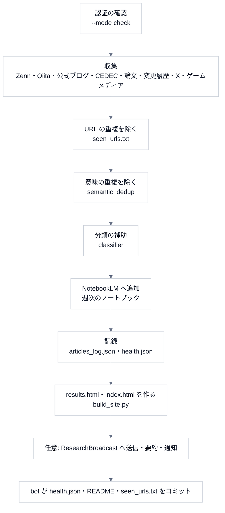

# 1. 全体像

## 何をするものか

**GitHub Actions × NotebookLM による技術情報の自動収集**です。毎日 2 回(JST 6:00・18:00)収集し、重複を除き、分類の補助を付け、週次のノートブックへ追加し、収集結果のページを作ります(講義[第 0 回](../lecture/00-introduction.md))。

## 1 日の流れ(`main.py --mode daily`)

**1 つの収集元が失敗しても、他は続ける**(`_collect(label, fn)` が例外を捕まえて記録する。失敗は `collectors/retry.py` が覚えて、次回に再試行)。

## 動くところ

| 何 | どこで | いつ |
|---|---|---|
| 毎日の収集 | GitHub Actions(`daily_collect.yml`)。`cron: 0 9,21 * * *`(UTC) | 毎日 2 回 |
| 週次のレポート | 同じ `main.py --mode weekly`(水・日) | 週 2 回 |
| 認証の自動更新 | **利用者の PC**(Windows のタスクスケジューラ。`refresh_auth.ps1`) | 毎日 2 回 |
| ローカル限定の収集 | 利用者の PC(`local_collect_extra.py`・`local_post_extra.py`) | 手動・タスク |

## データの置き場所

| 何を | どこに | 備考 |
|---|---|---|
| 収集済みの URL(ハッシュ) | `seen_urls.txt` | 1 行 1 ハッシュ(SHA-256 の先頭 16 文字)。**増え続ける** |
| 追加した記事の記録 | `articles_log.json` | 期限で刈り込む(`_prune`) |
| 実行の健康状態 | `health.json` | README の表にも反映される |
| 収集結果ビュー | `results.html`・`index.html` | `build_site.py` が生成 |
| ノートブック | NotebookLM(週次・カテゴリ別) | 古いものは `notebook_cleanup` が整理 |
| ログ | `output/`(Actions の成果物 14 日) | |

## 設定(Secrets・環境変数)

| 名前 | 用途 |
|---|---|
| `NOTEBOOKLM_AUTH_JSON` | NotebookLM の認証(ブラウザの認証情報。**期限がある**) |
| `NOTEBOOKLM_WEEKLY_DIGEST_ID` | 週次ダイジェストのノートブック |
| `NOTION_TOKEN` | Notion への保存(任意) |
| `ANTHROPIC_API_KEY` | 要約・インサイトの生成(任意) |
| `SEMANTIC_SCHOLAR_API_KEY` | 論文の検索の上限を上げる(任意) |
| `SEMANTIC_DEDUP`・`SEMANTIC_DEDUP_THRESHOLD` | 意味の重複の無効化・しきい値 |

> 秘密は、**リポジトリの Secrets・環境変数**で渡し、ファイルに書かない。
